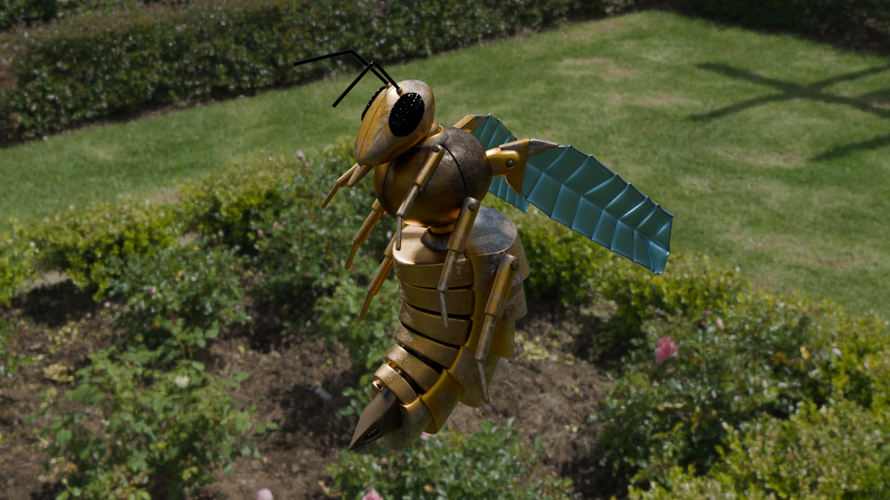

# 3D_models
A collection of my own 3D models made in Blender.

I started learning Blender by myself by watching YouTube videos.

One of my first models was this polygon character:

It is very simple, but I was proud of myself for learning the Blender basics, because at first I thought it would be impossible.

Then I signed up for a school course, where I learned more about Blender and created more models.

For my final project, I had to come up with a robot of my own, so I made this little bee:

